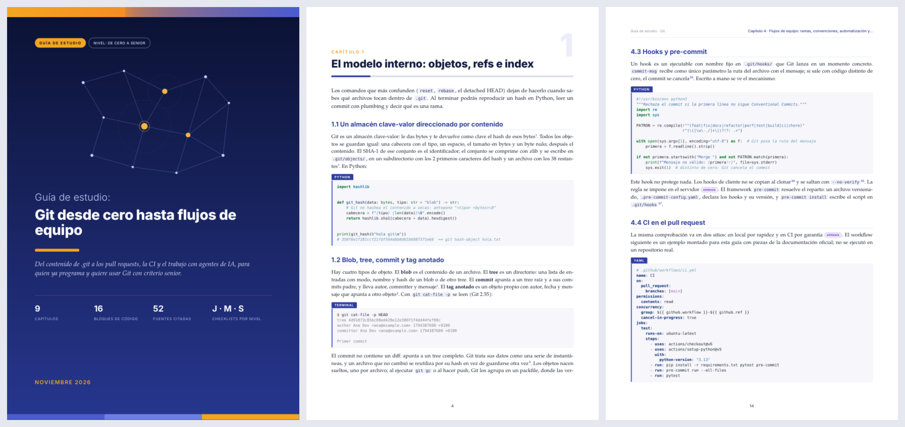

# Selftaught

[English](README.md) · **Español**

Una skill de [Claude Code](https://claude.com/claude-code) que convierte "hazme una guía de
estudio sobre X" en un PDF largo y maquetado del que puedes estudiar durante semanas.

La skill investiga el tema con varios subagentes en paralelo, escribe una guía ordenada de
lo básico a lo avanzado, comprueba cada ejemplo de código, genera el PDF y revisa las
páginas renderizadas antes de entregarlo.



Un ejemplo completo, generado por la skill a partir de la petición "Git desde cero hasta
flujos de equipo":
[examples/Git desde cero hasta equipo.pdf](examples/Git%20desde%20cero%20hasta%20equipo.pdf).

## Qué contiene una guía

- Un resumen, la leyenda de etiquetas de fiabilidad y un mapa de la ruta de aprendizaje.
- Capítulos numerados en orden de estudio. Cada idea se explica por su mecanismo (cómo se ve
  por dentro) y se muestra en código corto y comentado: Python primero, y archivos de
  configuración reales donde aplican.
- Al final de cada capítulo, un checklist por nivel (junior, mid, senior) y una tabla de
  preguntas de entrevista con lo que incluye una respuesta senior.
- Al final de la guía, un plan de estudio semanal con un proyecto integrador, recursos
  priorizados, un glosario y las respuestas de autoevaluación.
- Cada dato va citado (un enlace numerado a la fuente, listada en un apéndice) o
  etiquetado: referencia canónica, conocimiento general, no verificado o síntesis propia de
  la guía. Ninguna cifra sin fuente se presenta como un hecho.

La guía se escribe en el idioma en que la pides. Los rótulos que imprime el generador están
en español y en inglés.

## Cómo funciona

```
intake → título y carpetas → descomposición → investigación en paralelo → redacción
       → revisión de código → PDF → QA visual → entrega
```

| Paso | Qué ocurre | Resultado |
|---|---|---|
| Investigación | Un subagente por subtema, más uno para "conceptos actuales importantes que no pediste". Primero fuentes primarias; cada dato etiquetado. | `research_notes/<título>/*.md` |
| Redacción | Un subagente escribe la guía solo a partir de las notas. | `reports/<título>.md` |
| Revisión de código | Python se analiza con `ast.parse`, YAML con `yaml.safe_load`, además de JSON, TOML y bash con `bash -n`. | correcto o una lista de errores |
| PDF | De markdown a HTML y a PDF con WeasyPrint. Los datos de la portada salen del front-matter. | `outputs/<título>.pdf` |
| QA visual | Se renderizan páginas de muestra a PNG y se revisan; se comprueba que no falte texto, que no haya páginas en blanco ni fuentes inesperadas. | `outputs/qa/*.png` |

## Instalación

Clona el repositorio en tu carpeta personal de skills:

```bash
git clone https://github.com/iggtht/Selftaught ~/.claude/skills/selftaught
```

Después instala las dependencias una vez (Debian, Ubuntu o WSL):

```bash
bash ~/.claude/skills/selftaught/scripts/setup.sh
```

El script instala Pango y Poppler con `apt`, crea el entorno virtual `~/.venvs/selftaught`
con los paquetes de Python y descarga las fuentes (Inter, TeX Gyre Pagella, DejaVu) en
`assets/fonts/`. Las fuentes no se guardan en este repositorio.

En Windows, ejecuta la instalación y los scripts dentro de WSL. En macOS, instala Pango y
Poppler con Homebrew (`brew install pango poppler`), crea el entorno virtual con
`scripts/requirements.txt` y ejecuta `scripts/fetch_fonts.py`.

## Uso

En Claude Code, pide una guía:

```
/selftaught Docker desde cero hasta producción
```

o con tus palabras: "hazme una guía de estudio sobre X", "guía completa de X",
"desglósame X desde cero".

Hay tres profundidades. La profundidad se elige según la petición; di "corta" o "a fondo"
para elegirla tú.

| Profundidad | Páginas | Subagentes de investigación | Capítulos |
|---|---|---|---|
| corta | 15–20 | 5 | 4–5 |
| estándar | 40–70 | 6–7 | 7–10 |
| a fondo | 80+ | 8 | 10–14 |

## Usar los scripts por separado

Los tres scripts funcionan con cualquier markdown que siga la estructura descrita en
[references/report-writer.md](references/report-writer.md).

```bash
python scripts/check_code.py "reports/Mi guía.md"
python scripts/build_pdf.py "reports/Mi guía.md" -o "outputs/Mi guía.pdf"
python scripts/qa_pdf.py "outputs/Mi guía.pdf" --source "reports/Mi guía.md"
```

`build_pdf.py` acepta `--title`, `--subtitle`, `--kicker`, `--short-title`, `--chips`,
`--date` y `--lang` para sustituir lo que diga el front-matter.

## Estructura del repositorio

```
SKILL.md                      el flujo que sigue la skill
references/
  researcher.md               instrucciones de cada investigador: fuentes, etiquetas, formato
  report-writer.md            instrucciones del redactor: estructura, código y citas
  pdf-style.md                el diseño del PDF y qué markdown produce cada elemento
scripts/
  build_pdf.py                de markdown a PDF
  check_code.py               revisión de sintaxis de los bloques de código
  qa_pdf.py                   páginas a PNG y comprobaciones del texto
  setup.sh, fetch_fonts.py    dependencias y fuentes
  requirements.txt
assets/
  style.css                   la hoja de estilos
  fonts/                      se llena con fetch_fonts.py
examples/                     una guía generada por la skill
```

Los archivos de la skill están en inglés; las guías salen en tu idioma.

## Lector por defecto

Las guías se escriben para un desarrollador autodidacta con cerca de un año de Python, que
trabaja con asistentes de IA y quiere llegar a nivel senior: explicaciones claras sin
simplificar de más, y siempre el código que enseña cómo funciona la cosa por dentro. Edita
la sección "Reader profile" de `SKILL.md` para cambiarlo.

## Licencia

MIT. Ver [LICENSE](LICENSE). Las fuentes que descarga `fetch_fonts.py` conservan sus
propias licencias (SIL Open Font License para Inter, GUST Font License para TeX Gyre
Pagella, licencia derivada de Bitstream Vera para DejaVu).
