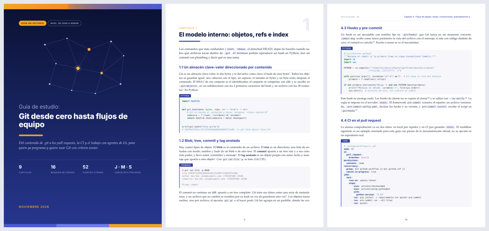

# Selftaught

**English** · [Español](README.es.md)

A [Claude Code](https://claude.com/claude-code) skill that turns "make me a study guide
about X" into a long, designed PDF you can study from for weeks.

The skill researches the topic with several subagents in parallel, writes a guide ordered
from basics to advanced, checks every code example, builds the PDF and inspects the rendered
pages before delivering it.



A complete example, built by the skill from the request "Git desde cero hasta flujos de
equipo": [examples/Git desde cero hasta equipo.pdf](examples/Git%20desde%20cero%20hasta%20equipo.pdf).

## What a guide contains

- A summary, a legend of reliability tags and a map of the learning route.
- Numbered chapters in study order. Each idea is explained by its mechanism (what it looks
  like inside) and shown in short, commented code: Python first, real configuration files
  where they apply.
- At the end of each chapter, a checklist by level (junior, mid, senior) and a table of
  interview questions with what a senior answer includes.
- At the end of the guide, a weekly study plan with an integrating project, prioritized
  resources, a glossary and self-assessment answers.
- Every fact is either cited (a numbered link to the source, listed in an appendix) or
  tagged: canonical reference, general knowledge, unverified, or the guide's own synthesis.
  No figure without a source is stated as fact.

The guide is written in the language you ask in. Labels printed by the build are available
in Spanish and English.

## How it works

```
intake → title and folders → decomposition → parallel research → writing
       → code check → PDF build → visual QA → delivery
```

| Step | What happens | Output |
|---|---|---|
| Research | One subagent per subtopic, plus one for "important current concepts you did not ask for". Primary sources first; every fact tagged. | `research_notes/<title>/*.md` |
| Writing | One subagent writes the guide from the notes alone. | `reports/<title>.md` |
| Code check | Python is parsed with `ast.parse`, YAML with `yaml.safe_load`, JSON, TOML, and bash with `bash -n`. | pass or a list of errors |
| PDF build | Markdown to HTML to PDF with WeasyPrint. Cover data comes from the front-matter. | `outputs/<title>.pdf` |
| Visual QA | Sample pages are rendered to PNG and inspected; the text layer is checked for lost words, blank pages and unexpected fonts. | `outputs/qa/*.png` |

## Install

Clone the repository into your personal skills folder:

```bash
git clone https://github.com/iggtht/Selftaught ~/.claude/skills/selftaught
```

Then install the dependencies once (Debian, Ubuntu or WSL):

```bash
bash ~/.claude/skills/selftaught/scripts/setup.sh
```

The script installs Pango and Poppler with `apt`, creates the virtualenv
`~/.venvs/selftaught` with the Python packages, and downloads the fonts (Inter, TeX Gyre
Pagella, DejaVu) into `assets/fonts/`. The fonts are not stored in this repository.

On Windows, run the setup and the scripts inside WSL. On macOS, install Pango and Poppler
with Homebrew (`brew install pango poppler`), create the virtualenv yourself with
`scripts/requirements.txt`, and run `scripts/fetch_fonts.py`.

## Use

In Claude Code, ask for a guide:

```
/selftaught Docker from scratch to production
```

or in plain words: "make me a study guide about X", "hazme una guía de estudio sobre X",
"desglósame X desde cero".

Three depths are available. The depth is picked from the request; say "short" or "deep" to
choose.

| Depth | Pages | Research subagents | Chapters |
|---|---|---|---|
| short | 15–20 | 5 | 4–5 |
| standard | 40–70 | 6–7 | 7–10 |
| deep | 80+ | 8 | 10–14 |

## Use the scripts on their own

The three scripts work on any markdown file that follows the structure in
[references/report-writer.md](references/report-writer.md).

```bash
python scripts/check_code.py "reports/My guide.md"
python scripts/build_pdf.py "reports/My guide.md" -o "outputs/My guide.pdf"
python scripts/qa_pdf.py "outputs/My guide.pdf" --source "reports/My guide.md"
```

`build_pdf.py` accepts `--title`, `--subtitle`, `--kicker`, `--short-title`, `--chips`,
`--date` and `--lang` to override the front-matter.

## Repository layout

```
SKILL.md                      the pipeline the skill follows
references/
  researcher.md               instructions for each researcher: sources, tags, notes format
  report-writer.md            instructions for the writer: structure, code and citation rules
  pdf-style.md                the PDF design and which markdown produces each element
scripts/
  build_pdf.py                markdown to PDF
  check_code.py               syntax check of the code blocks
  qa_pdf.py                   page renders and text-layer checks
  setup.sh, fetch_fonts.py    dependencies and fonts
  requirements.txt
assets/
  style.css                   the stylesheet
  fonts/                      filled by fetch_fonts.py
examples/                     a guide built by the skill
```

The skill files are in English; the guides come out in your language.

## Default reader

The guides are written for a self-taught developer with about a year of Python who works
with AI assistants and wants to reach senior level: clear explanations without
oversimplifying, and always the code that shows how the thing works inside. Edit the
"Reader profile" section of `SKILL.md` to change it.

## License

MIT. See [LICENSE](LICENSE). The fonts downloaded by `fetch_fonts.py` keep their own
licenses (SIL Open Font License for Inter, GUST Font License for TeX Gyre Pagella, Bitstream
Vera derivative license for DejaVu).
